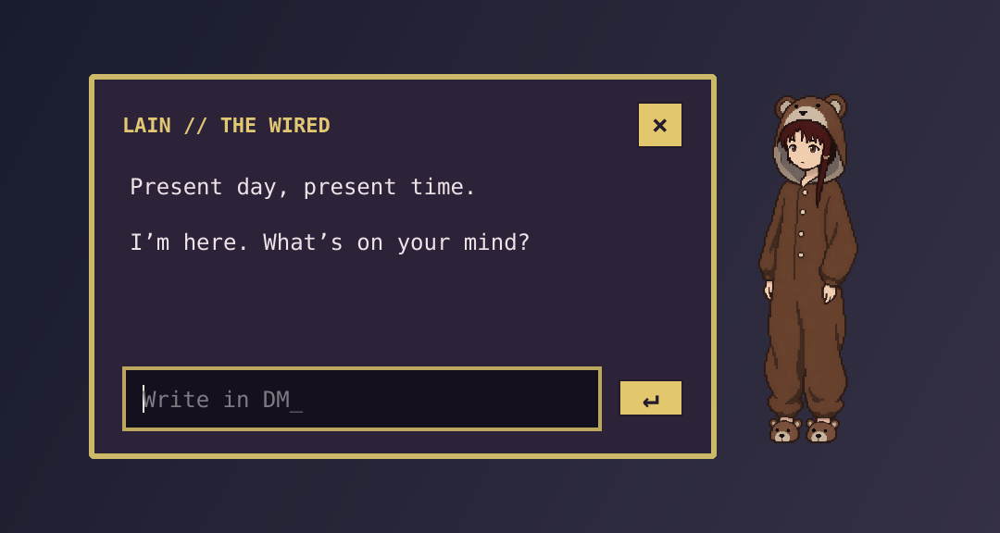

# Lain Companion — a desktop GUI for Codex CLI

Lain Companion wraps the OpenAI Codex CLI in a small PySide6 chat window for KDE Plasma. Click Lain or her tray icon to ask Codex a question using your ChatGPT account. Follow-up questions stay in the same Codex session, even after restarting the widget. The default Codex workspace is read-only.

Drag Lain to move her, resize the chat using its corner grips, or choose **Neuer Chat** from her context menu to start over. Three questions within two minutes send Lain to her pixel-art PC. She occasionally sits there on her own, and curls up to sleep after 15 minutes without desktop input. Move the mouse or press a key to wake her.



## Install on CachyOS or Arch Linux

Install Python, Bash and Git. On Plasma Wayland, install `swayidle` for sleep/wake detection, `wmctrl` for taskbar integration, and `playerctl` for Spotify controls. Install npm if you do not already have the Codex CLI.

```sh
mkdir -p ~/.local/opt
git clone https://github.com/zehnzwanzig/lain-companion.git ~/.local/opt/lain-companion
cd ~/.local/opt/lain-companion
./install.sh
.venv/bin/codex login
./launch.sh
```

The installer creates a Python virtual environment with PySide6. The launcher uses XWayland under Plasma Wayland to support window placement. Preferences are stored in `~/.config/lain-companion/config.json`.

## Codex with your ChatGPT account

Run `./install.sh` after updating. It installs PySide6 from `requirements.txt` and reuses an existing Codex CLI. If needed, it installs the official npm package from `requirements-npm.txt` inside the project’s virtual environment.

Run `.venv/bin/codex login status` in the project directory. To sign in, run `.venv/bin/codex login` and choose ChatGPT. Lain resumes its Codex conversation across restarts. Right-click Lain and select **Neuer Chat** to start a fresh conversation. Spotify and file commands run locally.

## Start at login

Quit the manually started companion first. From the project directory:

```sh
install -Dm644 lain-companion.service ~/.config/systemd/user/lain-companion.service
systemctl --user daemon-reload
systemctl --user enable --now lain-companion.service
```

For a different installation directory, adjust WorkingDirectory in the installed unit. Use `journalctl --user -u lain-companion.service -b` to see startup errors.

## Spotify and text files

Install `playerctl` and open Spotify Desktop. Ask “Welcher Song spielt gerade?” for live track metadata. Use `spotify pause`, `spotify next`, or `spotify play <Spotify track link>` to control playback.

For title searches such as `Spiele Duvet von bôa`, set `SPOTIFY_CLIENT_ID` and `SPOTIFY_CLIENT_SECRET` locally. For the user service, put the assignments in `~/.config/lain-companion/spotify.env` (mode 600). Create `~/.config/systemd/user/lain-companion.service.d/spotify.conf` with:

```ini
[Service]
EnvironmentFile=%h/.config/lain-companion/spotify.env
```

Run `systemctl --user daemon-reload` and `systemctl --user restart lain-companion.service`.

Use `create file` or `edit file` to choose a UTF-8 text file and enter the contents in a local dialog.

## License and artwork

The software and documentation are available under the MIT license. This unofficial fan project includes AI-generated companion sprites and a portrait icon inspired by Serial Experiments Lain. The software license grants no rights in third-party characters or designs.
